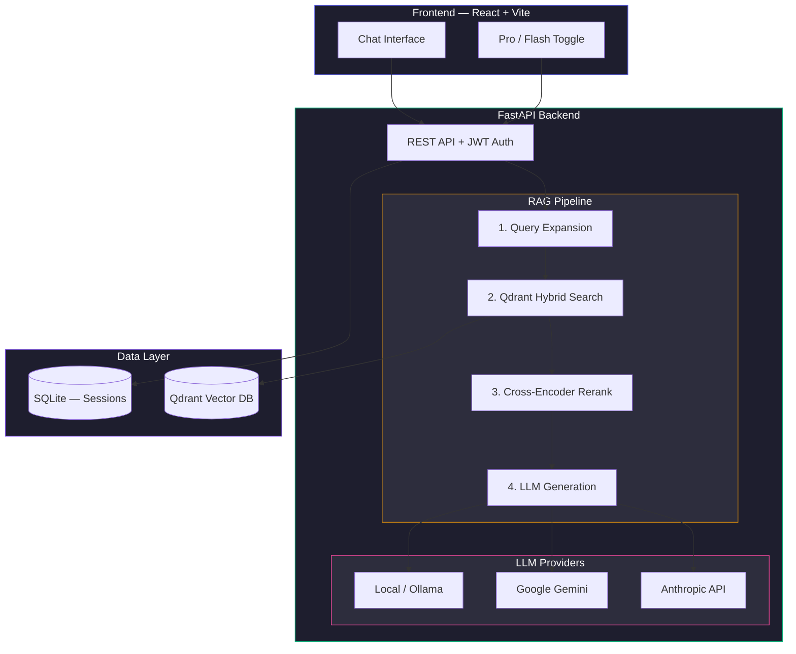

<p align="center">
  
  
  
  
  
</p>

<h1 align="center">RagLaw</h1>

<p align="center">
  <strong>Vietnamese Legal Document RAG System</strong>
</p>

<p align="center">
  Retrieval-Augmented Generation for Vietnamese legal question answering,<br>
  powered by Qdrant hybrid search, cross-encoder reranking, and multi-LLM support.
</p>

---

## Features

| Category | Highlights |
|----------|------------|
| **Retrieval** | Qdrant hybrid search (dense + sparse), RRF fusion, cross-encoder reranking |
| **Embeddings** | 4 Vietnamese models benchmarked – `hcmute_wseg` (NDCG 0.908) is default |
| **LLMs** | Anthropic-compatible proxy, Google Gemini, OpenAI, local Ollama |
| **Pipeline** | Unified + Qdrant pipelines, query expansion, HyDE, Pro/Flash modes |
| **Auth** | JWT authentication, session management, SQLAlchemy database |
| **Frontend** | React + Vite SPA, markdown rendering, clickable citations |

---

## Architecture



---

## Quick Start

### Prerequisites

- Python 3.10+
- Node.js 18+
- Docker (for Qdrant)

### 1. Clone & Install

```bash
git clone https://github.com/your-repo/RagLaw.git
cd RagLaw

# Python environment
conda create -n raglaw python=3.10 -y
conda activate raglaw
pip install -r requirements.txt

# Frontend
cd frontend && npm install && cd ..
```

### 2. Configure

```bash
cp .env.example .env
# Edit .env — set your API keys and adjust settings
```

### 3. Start Services

```bash
# Start Qdrant vector database
docker compose up -d qdrant

# Ingest legal documents into Qdrant
python -m backend.rag.ingest_qdrant

# Start backend
uvicorn backend.app:app --port 8000

# Start frontend (in a separate terminal)
cd frontend && npm run dev
```

Frontend: `http://localhost:5173` · Backend API: `http://localhost:8000/docs`

---

## Configuration

All settings are configurable via environment variables. See [`.env.example`](.env.example) for the full reference.

### Key Settings

| Variable | Default | Description |
|----------|---------|-------------|
| `QDRANT_HOST` | `localhost` | Qdrant server host |
| `QDRANT_PORT` | `6333` | Qdrant REST API port |
| `QDRANT_RETRIEVAL_MODE` | `hybrid` | `hybrid` · `dense` · `sparse` |
| `EMBEDDING_MODEL` | `hcmute_wseg` | Embedding model key |
| `USE_RERANK` | `true` | Enable cross-encoder reranking |
| `ANTHROPIC_API_KEY` | — | Primary LLM provider key |
| `GEMINI_API_KEY` | — | Fallback LLM provider key |

### Embedding Models

| Key | Model | Dim | NDCG@10 | Notes |
|-----|-------|-----|---------|-------|
| `hcmute_wseg` | `huyydangg/DEk21_hcmute_embedding_wseg` | 768 | **0.908** | Best — requires word segmentation |
| `vietnamese_v2` | `AITeamVN/Vietnamese_Embedding_v2` | 768 | 0.843 | General Vietnamese |
| `bge_m3` | `BAAI/bge-m3` | 1024 | 0.784 | Multilingual |
| `vietnamese` | `AITeamVN/Vietnamese_Embedding` | 768 | 0.843 | Lightweight |

---

## API Reference

### Endpoints

| Method | Endpoint | Auth | Description |
|--------|----------|------|-------------|
| `GET` | `/api/health` | — | System health check |
| `GET` | `/api/stats` | — | Pipeline statistics |
| `POST` | `/api/v1/chat` | Optional | Chat with RAG |
| `POST` | `/api/v1/chat/mcq` | Optional | MCQ answering |
| `POST` | `/api/v1/chat/nli` | Optional | NLI answering |
| `POST` | `/api/v1/auth/register` | — | User registration |
| `POST` | `/api/v1/auth/login` | — | Login (returns JWT) |
| `GET` | `/api/v1/sessions` | Required | List chat sessions |
| `POST` | `/api/v1/documents/upload` | Required | Upload legal documents |

### Chat Request

```json
{
  "query": "Điều kiện thành lập doanh nghiệp là gì?",
  "session_id": "optional-uuid",
  "mode": "flash",
  "use_rag": true,
  "top_k": 5
}
```

### Chat Response

```json
{
  "answer": "Theo Điều 17, Luật Doanh nghiệp 2020...",
  "citations": ["Điều 17, Luật Doanh nghiệp 2020"],
  "sources": [
    {
      "text": "...",
      "score": 0.912,
      "law_id": "luat-doanh-nghiep-2020",
      "article_title": "Điều 17. Quyền của doanh nghiệp"
    }
  ],
  "confidence": 0.85,
  "model_used": "Gemini"
}
```

---

## Project Structure

```
RagLaw/
├── backend/
│   ├── agents/                 # Query analysis & expansion
│   ├── core/                   # Database, security, models
│   │   ├── database.py         # SQLAlchemy engine & session
│   │   ├── security.py         # JWT auth & password hashing
│   │   └── models/             # User, ChatSession, Message
│   ├── intelligence/           # AI facade (re-exports)
│   ├── legal/                  # Vietnamese legal document parser
│   ├── llm/                    # LLM providers (Gemini, Anthropic, HF)
│   ├── rag/                    # RAG pipeline
│   │   ├── base_pipeline.py    # Abstract pipeline interface
│   │   ├── pipeline.py         # UnifiedRAGPipeline (legacy)
│   │   ├── qdrant_pipeline.py  # QdrantRAGPipeline (new)
│   │   ├── qdrant_store.py     # Qdrant vector store wrapper
│   │   ├── ingest_qdrant.py    # Document ingestion CLI
│   │   ├── engines/            # BM25, Dense, Hybrid engines
│   │   ├── multi_retriever.py  # Multi-index retriever
│   │   └── hyde.py             # Hypothetical Document Embeddings
│   ├── routers/                # API endpoints
│   │   ├── auth.py             # /auth — register, login
│   │   ├── chat.py             # /chat — RAG Q&A
│   │   ├── sessions.py         # /sessions — history
│   │   └── documents.py        # /documents — upload & index
│   ├── schemas/                # Pydantic request/response models
│   ├── services/               # Business logic
│   │   ├── auth_service.py     # User registration & auth
│   │   ├── chat_service.py     # RAG orchestrator
│   │   ├── session_service.py  # Chat session CRUD
│   │   └── document_service.py # Document management
│   ├── app.py                  # FastAPI application
│   └── config.py               # Configuration (env-driven)
│
├── frontend/                   # React + Vite SPA
│   ├── src/
│   │   ├── App.jsx
│   │   ├── components/         # Chat, DocumentBrowser, etc.
│   │   └── styles/
│   ├── package.json
│   └── vite.config.js
│
├── data/
│   ├── laws/                   # Legal document corpus
│   └── index/                  # Legacy FAISS indexes
│
├── docker-compose.yaml         # Qdrant service
├── .env.example                # Environment template
├── requirements.txt            # Python dependencies
└── README.md
```

---

## License

This project is licensed under the MIT License.

---

## Acknowledgments

- [Qdrant](https://qdrant.tech/) — Vector search engine
- [VLSP](https://vlsp.org.vn/) — Vietnamese Language and Speech Processing
- [sentence-transformers](https://www.sbert.net/) — Embedding models
- [bm25s](https://github.com/xhluca/bm25s) — Fast BM25 implementation
- [ViLeXa](https://github.com/your-ref/ViLeXa) — Architecture reference
