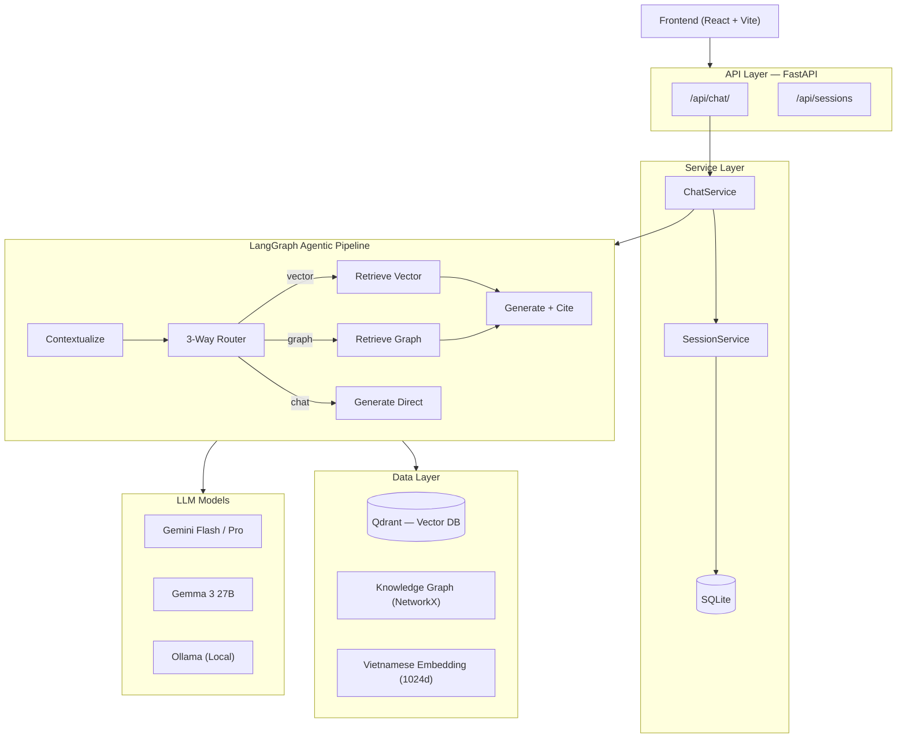
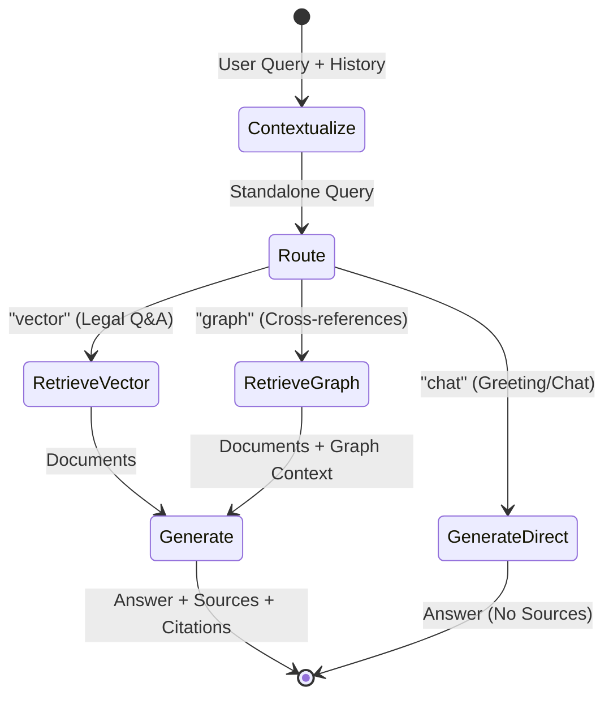

<p align="center">
  
  
  
  
  
  
  
  
  
  
</p>

<h1 align="center">⚖️ RagLaw</h1>

<h3 align="center">Agentic RAG System for Vietnamese Legal Document Q&A</h3>

<p align="center">
  An end-to-end <b>Retrieval-Augmented Generation</b> system that leverages <b>LangGraph agentic orchestration</b>,<br>
  <b>Qdrant vector search</b>, <b>Knowledge Graph traversal</b>, and <b>multi-model LLM inference</b><br>
  to deliver accurate, cited answers about Vietnamese law with <b>real-time streaming</b>.
</p>

<br>

---

## Table of Contents

- [Key Highlights](#key-highlights)
- [System Architecture](#system-architecture)
- [Agentic Pipeline Deep Dive](#agentic-pipeline-deep-dive)
- [Tech Stack](#tech-stack)
- [Project Structure](#project-structure)
- [Getting Started](#getting-started)
- [API Reference](#api-reference)
- [License](#license)

---

## Key Highlights

<table>
<tr>
<td width="50%">

### Agentic RAG Pipeline
Not a simple retrieve-then-generate. Uses a **LangGraph state machine** with intelligent routing, contextual query reformulation, and multi-strategy retrieval.

</td>
<td width="50%">

### 3-Way Smart Router
LLM classifies queries into `vector` (content search), `graph` (relationship traversal), or `chat` (direct response) for optimal retrieval strategy.

</td>
</tr>
<tr>
<td>

### History-Aware Contextualizer
Rewrites follow-up questions into standalone queries using conversation history, solving the classic **multi-turn RAG problem**.

</td>
<td>

### Knowledge Graph + Vector Hybrid
Combines **NetworkX** legal entity graph with **Qdrant** dense vector search for comprehensive document discovery.

</td>
</tr>
<tr>
<td>

### Inline Citations
LLM responses include verifiable `[1]`, `[2]` references mapped to expandable source document cards.

</td>
<td>

### Multi-Model Hot Swap
**Gemini Flash**, **Gemini Pro**, **Gemma 3 27B**, and **local Ollama** — switch models per-message without restart.

</td>
</tr>
</table>

---

## System Architecture



---

## Agentic Pipeline Deep Dive

### Pipeline Flow

The core of the system is a **stateful, graph-based pipeline** built with [LangGraph](https://github.com/langchain-ai/langgraph). Unlike traditional linear RAG, each query flows through an intelligent decision graph:



### Node Details

| # | Node | Input → Output | Technique |
|:---:|---|---|---|
| ① | **Contextualize** | `(query, history)` → `standalone_query` | LLM rewrites follow-up using `MessagesPlaceholder` |
| ② | **Route** | `standalone_query` → `{vector \| graph \| chat}` | Zero-shot LLM classification (3-class) |
| ③a | **Retrieve Vector** | `query` → `documents[]` | Qdrant dense cosine similarity (top-k=10) |
| ③b | **Retrieve Graph** | `query` → `documents[] + graph_context` | NetworkX BFS (2-hop) → Qdrant hybrid → merge + dedup |
| ③c | **Generate Direct** | `(query, history)` → `answer` | LLM direct response (no context) |
| ④ | **Generate + Cite** | `(query, documents, history)` → `(answer, sources)` | LLM with mandatory `[1][2]` citation injection |

### State Schema

```python
class AgenticState(TypedDict):
    query: str                        # Original user question
    current_query: str                # Rewritten standalone query
    history: List[BaseMessage]        # Conversation history (LangChain format)
    documents: List[Document]         # Retrieved documents from Qdrant/KG
    retrieval_mode: str               # "chat" | "vector" | "graph"
    needs_retrieval: bool             # Router decision flag
    answer: str                       # Final generated answer
    sources: List[Dict[str, Any]]     # Source citations with metadata
    model_name: str                   # Active LLM model key
```

### Multi-Turn Context Resolution

```
Turn 1:  "Quyền sở hữu tài sản?"
         → Contextualize: keeps as-is (no history)
         → Route: vector → Qdrant search
         → Answer: "Theo Điều 158 BLDS 2015... [1]"

Turn 2:  "Giải thích chi tiết hơn"
         → Contextualize: rewrites to "Giải thích chi tiết về quyền sở hữu
            tài sản theo Điều 158 Bộ luật Dân sự 2015"
         → Route: vector → accurate results with full context

Turn 3:  "Điều này liên quan tới những văn bản nào?"
         → Contextualize: rewrites to "Điều 158 BLDS 2015 về quyền
            sở hữu tài sản liên quan tới những văn bản pháp luật nào?"
         → Route: graph (cross-reference question)
         → KG traversal + Qdrant → comprehensive related documents
```

---

## Tech Stack

| Layer | Technology | Purpose |
|---|---|---|
| **API Framework** | FastAPI | Async REST API with auto-generated OpenAPI docs |
| **Orchestration** | LangGraph | Stateful agent graph with conditional routing |
| **LLM Framework** | LangChain | Prompt templates, output parsers, chat model abstraction |
| **Vector Database** | Qdrant | Dense/hybrid/sparse semantic retrieval |
| **Knowledge Graph** | NetworkX | Legal document relationship graph with BFS traversal |
| **Embeddings** | SentenceTransformers | `AITeamVN/Vietnamese_Embedding_v2` (1024 dims) |
| **LLM Models** | Google Gemini API | Flash 2.0, Pro 1.5, Gemma 3 27B-IT |
| **Local LLM** | Ollama | Offline inference (llama3, gemma3:4b) |
| **ORM** | SQLAlchemy | Session & message persistence |
| **Database** | SQLite | Lightweight, zero-config storage |
| **Frontend** | React 18 + Vite | SPA with hot module replacement |
| **Markdown** | ReactMarkdown + remark-gfm | Rich text rendering with LaTeX support |
| **Streaming** | Server-Sent Events (SSE) | Real-time token streaming + thought events |
| **Styling** | CSS3 | Glassmorphism, dark mode, micro-animations |

---

## Project Structure

```
RagLaw/
│
├── backend/
│   ├── app.py                         # FastAPI application factory + CORS + lifespan
│   ├── config.py                      # Pydantic Settings (environment-based config)
│   │
│   ├── core/                          # Database & ORM models
│   │   ├── database.py                # SQLAlchemy engine, sessionmaker, get_db()
│   │   └── models/
│   │       ├── session.py             # ChatSession model
│   │       └── message.py             # Message model (role, content, sources)
│   │
│   ├── rag/                           # RAG Pipeline (core intelligence)
│   │   ├── langchain_pipeline.py      # LangGraph agentic pipeline (528 lines)
│   │   ├── knowledge_graph.py         # NetworkX KG builder + traversal
│   │   ├── graph_pipeline.py          # GraphRAG hybrid pipeline
│   │   ├── adk_pipeline.py            # Google ADK agent pipeline
│   │   ├── adapters.py                # Vietnamese embedding/sparse adapters
│   │   ├── data_loader.py             # Legal document JSON loader + splitter
│   │   └── ingest_qdrant.py           # Qdrant collection builder
│   │
│   ├── routers/                       # FastAPI route handlers
│   │   ├── chat.py                    # POST /chat, /chat/stream, /chat/adk/stream
│   │   ├── sessions.py                # CRUD /sessions
│   │   ├── documents.py               # GET /documents/{id}
│   │   ├── graph.py                   # GET /graph/stats, /graph/stream
│   │   └── health.py                  # GET /health
│   │
│   └── services/                      # Business logic layer
│       ├── chat_service.py            # ChatService (pipeline + in-memory history)
│       ├── session_service.py         # Session CRUD + auto-titling
│       ├── document_service.py        # Document lookup
│       └── lookup_service.py          # Full-text document search
│
├── frontend/
│   └── src/
│       ├── App.jsx                    # Root component (theme management)
│       ├── components/
│       │   ├── ChatInterface.jsx      # Main chat UI 
│       │   └── ChatInterface.css      # Glassmorphism dark-mode styling
│       └── styles/
│           ├── index.css              # Design tokens & CSS variables
│           └── App.css                # Layout & background decorations
│
├── data/                              # Legal document corpus
│   ├── laws/legal_corpus.json         # Vietnamese law articles (Git LFS)
│   └── law_graph.json                 # Pre-built Knowledge Graph
│
├── requirements.txt                   # Python dependencies
├── .env                               # Environment configuration
└── README.md                          # You are here
```

---

## Getting Started

### Prerequisites

| Requirement | Version |
|---|---|
| Python | 3.10+ |
| Node.js | 18+ |
| Docker | 20+ (for Qdrant) |
| Google API Key | [Gemini API](https://aistudio.google.com/apikey) |

### 1. Clone & Install

```bash
git clone https://github.com/noskaiser2310/RagLaw.git
cd RagLaw

# Backend
pip install -r requirements.txt

# Frontend
cd frontend && npm install && cd ..
```

### 2. Configure Environment

```bash
cp .env.example .env
```

```env
GOOGLE_API_KEY=your_gemini_api_key
QDRANT_HOST=localhost
QDRANT_PORT=6333
COLLECTION_NAME=laws
EMBEDDING_MODEL=AITeamVN/Vietnamese_Embedding_v2
```

### 3. Start Qdrant (Docker)


```bash
docker run -d --name qdrant \
  -p 6333:6333 -p 6334:6334 \
  -v $(pwd)/qdrant_storage:/qdrant/storage \
  qdrant/qdrant
```


### 4. Prepare Data

The legal corpus (`data/laws/legal_corpus.json`, ~114 MB) is tracked via **Git LFS** and will be downloaded automatically on `git clone`. If it wasn't pulled:

```bash
git lfs pull
```

**Corpus format:**

```json
[
  {
    "law_id": "Luật 59/2020/QH14",
    "articles": [
      {
        "article_id": "Điều 1",
        "title": "Phạm vi điều chỉnh",
        "text": "Luật này quy định về..."
      }
    ]
  }
]
```

> **Using your own data:** Place any `.json` files following the above schema into `data/laws/`. The loader supports both array-of-laws and single-law-dict formats.

### 5. Ingest & Build (requires Qdrant running)

```bash
# Ingest legal documents into Qdrant (embeds + indexes all articles)
python -m backend.rag.ingest_qdrant

# Build Knowledge Graph from corpus
python -m backend.rag.knowledge_graph --build --data-dir data
```

### 6. Run

```bash
# Terminal 1 — Backend (port 8001)
uvicorn backend.app:app --reload --port 8001

# Terminal 2 — Frontend (port 5174)
cd frontend && npm run dev
```

Open **http://localhost:5174** → Start chatting! 🎉

### Docker Compose (Full Stack)

One-command deployment:

```bash
# Start all services (Qdrant + Backend + Frontend)
docker-compose up -d

# Check status
docker-compose ps

# View logs
docker-compose logs -f backend
```

The `docker-compose.yml` includes:
- **Qdrant** — vector database with health checks (port `6333`)
- **Backend** — FastAPI server (port `8001`), waits for Qdrant to be healthy
- **Frontend** — React app (port `5174`)

> **Note:** Before running, make sure `.env` is configured with your `GOOGLE_API_KEY`. Data ingestion and KG building still need to be run manually (see steps 4 & 5 above).

---

## API Reference

### Chat

| Method | Endpoint | Description | Response |
|---|---|---|---|
| `POST` | `/api/chat` | Synchronous chat | `{reply, sources, session_id}` |
| `POST` | `/api/chat/stream` | SSE streaming (thoughts + tokens) | `text/event-stream` |
| `POST` | `/api/chat/adk/stream` | Google ADK agent streaming | `text/event-stream` |

**Request body:**
```json
{
  "message": "Điều kiện kết hôn theo luật Việt Nam?",
  "session_id": "optional-uuid",
  "model": "gemini",
  "mode": "flash"
}
```

**SSE Event Types:**
| Type | Description | Example |
|---|---|---|
| `status` | Pipeline status | `"🔍 Đang phân tích..."` |
| `thought` | Agent step visibility | `{agent: "Router", text: "📊 Vector Search"}` |
| `sources` | Retrieved documents | `[{content, metadata}]` |
| `chunk` | Streamed answer token | `"Theo Điều"` |
| `done` | Stream complete | `""` |

### Sessions

| Method | Endpoint | Description |
|---|---|---|
| `GET` | `/api/sessions` | List all sessions |
| `GET` | `/api/sessions/{id}` | Get session + messages |
| `DELETE` | `/api/sessions/{id}` | Delete session |

### Other

| Method | Endpoint | Description |
|---|---|---|
| `GET` | `/api/documents/{id}` | Lookup legal document by ID |
| `GET` | `/api/graph/stats` | Knowledge Graph statistics |
| `GET` | `/api/health` | System health check |

📄 **Interactive docs:** `http://localhost:8001/docs` (Swagger UI)


---

## License

This project is licensed under the MIT License — see the [LICENSE](LICENSE) file for details.

---

<p align="center">
  <b>Built with ❤️ by Kaiser</b><br>
  <sub>⚖️ Empowering legal knowledge access through AI</sub>
</p>
